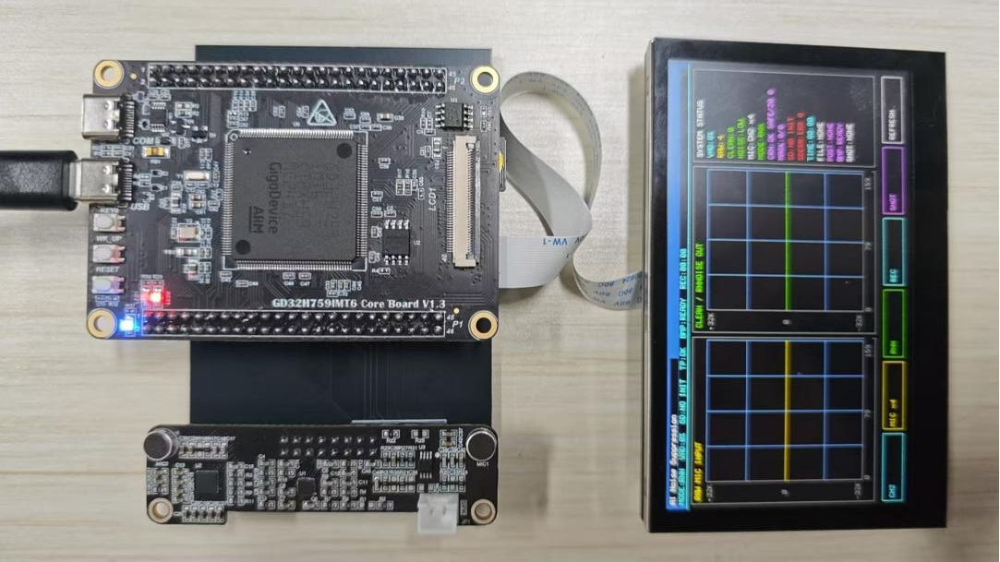
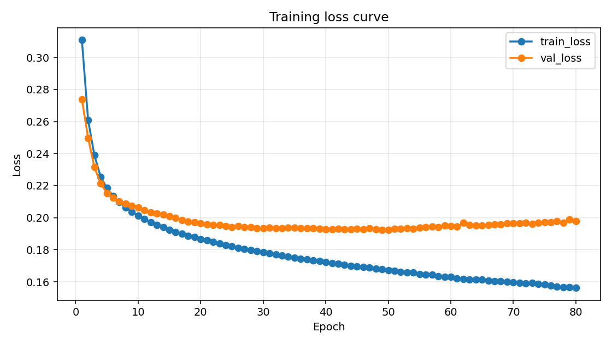

# 基于 GD32H759I 的 Tiny-CRN 边缘语音降噪系统

面向嵌入式语音增强的软硬件项目，包含 **GD32H759I 开发板固件、板端性能测试工程、PyTorch 模型训练、离线评估与 ONNX 导出**。

采用轻量级卷积循环网络（Tiny-CRN）预测频带掩蔽，在微控制器上完成语音降噪处理，并提供 LCD 触摸交互、波形显示和 TF 卡 WAV 录音。

## 项目实物

<p align="center">
  
</p>

> **当前实现边界**：录音时优先采集并保存原始音频，停止录音后在板端离线生成 CRN / RNNoise 降噪文件。非录音状态下提供低频刷新预览，**不是连续 10 ms 全链路实时 CRN 降噪或实时耳返系统**。板端量化映射仍需与转换工具的精确参数进一步对齐。

## 项目内容

- **主固件**：SAI/TDM 音频采集、DMA 双缓冲、SDRAM 软件队列、LCD 波形、触摸控制及 TF 卡文件管理。
- **降噪算法**：Tiny-CRN 频带掩蔽推理；保留 RNNoise 作为另一种处理模式。
- **性能测试版**：通过 Cortex-M7 DWT 周期计数器统计采集、特征提取、推理、重建、刷屏及写卡耗时。
- **训练与部署**：在线混噪数据集、训练与可视化、单文件降噪、批量评估、ONNX 导出及 INT8 校准数据生成。
- **已有模型**：保留提交材料中的 `best.pt`、ONNX 和板端生成的 C 模型参数，便于继续实验。

## 系统流程

```text
PC 训练与导出
干净语音 + 噪声 -> 随机 SNR 混合 -> STFT / 32 频带特征
  -> 8 帧上下文 -> Tiny-CRN -> 频带 mask
  -> PyTorch checkpoint -> ONNX -> GD Embedded AI Tool -> 板端 C 模型

开发板处理
麦克风 / ES7210 -> SAI/TDM + DMA -> SDRAM 队列 -> RAW 录音
  -> 停止录音 -> STFT -> INT8 CRN 推理 -> mask -> iFFT / OLA
  -> TF 卡降噪 WAV
```

## 仓库结构

```text
firmware/
  app/                 主固件，包含完整驱动、AI 库和 Keil 工程
  benchmark/           独立的板端性能测试工程
training/
  configs/             48 kHz 正式 / 轻量 / 冒烟配置及 16 kHz 实验配置
  tinycrn/             模型、音频处理、特征、数据集和可视化
  tools/               文件列表生成与实验绘图工具
  train.py             模型训练
  eval_denoise.py       单个音频文件降噪
  eval.py              多噪声、多 SNR 评估
  export_onnx.py        ONNX 导出
  make_npz_for_gd32.py  校准数据生成
  main.py              一键串联训练与导出
  runs/train/best.pt   原始训练权重
  exports/             原始 ONNX 模型
docs/
  PROJECT_ANALYSIS.md  源码分析、限制与后续改进方向
  SOURCE_MAP.md        原始材料与仓库的对应关系
  VALIDATION.md        本次整理的验证记录
  results/             原始训练曲线、训练日志和评估汇总
tools/                 仓库完整性检查和 PC 冒烟测试
```

`firmware/app` 和 `firmware/benchmark` 是两个可独立打开的工程，保留原有相对路径，避免重构驱动布局影响 Keil 构建。原目录名虽为 `GD32H779I`，工程实际选择的器件为 **GD32H759IM**，因此以工程配置为准。

## 硬件与开发环境

| 项目 | 源码 / 工程配置 |
| --- | --- |
| 主控 | GD32H759IM，Cortex-M7 |
| 音频采集 | ES7210，SAI/TDM，48 kHz |
| 音频输出 | 含 ES8311 驱动；默认 `ENABLE_ES8311_OUTPUT=0` |
| 显示与交互 | LCD 与触摸控制，具体引脚以 `Drivers/BSP` 为准 |
| 缓冲与存储 | SDRAM、TF/SD 卡、FatFs |
| IDE / 编译器 | Keil MDK，工程记录 Arm Compiler 6.22 |
| 设备包 | `GigaDevice.GD32H7xx_DFP.1.4.0` |
| 板端 AI 库 | 随工程保留 `GD_LIB_CM7_v210.lib` 及配套头文件 |
| 调试串口 | 初始化波特率 460800；主固件默认关闭串口控制命令 |

本仓库不包含开发板原理图或通用接线保证。更换开发板时，应核对音频接口、LCD、触摸、SDRAM 和 TF 卡引脚。

## 开发板编译与使用

1. 安装 Keil MDK、匹配的设备包与 Arm Compiler。
2. 主固件打开 `firmware/app/Projects/MDK-ARM/GD32H759.uvprojx`。
3. 性能测试打开 `firmware/benchmark/Projects/MDK-ARM/GD32H759.uvprojx`。
4. 选择现有 `USART` target。该名称是历史工程名称，实际应用为语音采集和降噪。
5. 在 Keil 中按实际硬件设置下载器与 Flash 下载选项，执行 Rebuild，再下载到开发板。
6. 插入已格式化且可写的 TF 卡，使用触摸界面切换声道、增益及 RAW / RNN / CRN 模式，开始或停止录音。

录音比较文件使用 `CMPxxxx.WAV` 命名；停止后按模式生成 `RNNxxxx.WAV` 或 `CRNxxxx.WAV`。默认固件不会自动格式化 TF 卡。具体声道内容和生成条件见 `User/sd_wav_recorder.c` 与 `User/main.c`。

> 本次仓库整理不等于重新完成硬件验证；未在连接开发板的 Keil 环境中重新编译、烧录或测量耗时。

## 模型结构与参数

```text
[B, 8, 32, 1]
  -> Conv2d(1 -> 8, 3x3) + ReLU
  -> Depthwise Conv2d(8 -> 8, 3x3) + ReLU
  -> Pointwise Conv2d(8 -> 16, 1x1) + ReLU
  -> 单层 LSTM(input=512, hidden=32)
  -> Linear(32 -> 32) + Sigmoid
  -> 当前帧 32 维频带 mask
```

| 参数 | 正式配置 |
| --- | --- |
| 采样率 | 48000 Hz |
| FFT / 窗长 / 帧移 | 1024 / 960 / 480 点 |
| 帧移时间 | 10 ms（不代表总系统延迟） |
| 频带数 / 上下文帧数 | 32 / 8 |
| 可训练参数量 | 71,248 |
| batch size / epochs | 48 / 80 |
| 优化器 / 学习率 | AdamW / 0.001 |
| 混噪 SNR | -5 至 20 dB |
| 损失 | mask L1 + 0.5 × 对数频带幅度 L1 |

配置中的 `steps_per_epoch=40000` 实际传给 Dataset 长度，表示每轮 **40,000 个样本**，不是 40,000 次优化器更新。详细实现见 `training/train.py` 和 `training/tinycrn/dataset.py`。

## PC 端快速开始

以下命令从仓库根目录执行。建议使用独立 Python 虚拟环境；PyTorch 按机器的 CPU / CUDA 环境单独安装。

```bash
cd training
python -m venv .venv
# Windows PowerShell: .\.venv\Scripts\Activate.ps1
# Linux / macOS: source .venv/bin/activate
python -m pip install torch==2.5.1
python -m pip install -r requirements.txt
```

上述 PyTorch 版本用于复现当前导出接口；CPU-only 安装可在该命令末尾添加 `--index-url https://download.pytorch.org/whl/cpu`。如升级 PyTorch，需重新检查 ONNX exporter 行为和 checkpoint 加载兼容性，不保证所有未来版本直接适用。

### 1. 准备训练数据

将自行获取并获准使用的干净语音和噪声音频分别放入 `training/data/clean` 和 `training/data/noise`。原始数据集、个人录音和本机绝对路径列表不随仓库发布。

```bash
python tools/build_filelists.py --clean_root data/clean --noise_root data/noise --out_dir filelists
```

脚本按文件随机划分 90% / 5% / 剩余部分。请确认训练、验证、测试列表均非空；少于 20 个文件的类别可能得到空验证集。严谨实验还应按说话人 / 录音来源隔离，避免同源数据泄漏。

### 2. 训练

```bash
# 先检查小规模训练流程
python train.py --config configs/tiny_crn_48k_smoke.yaml --run_name smoke_check

# 正式训练，使用新名称保护随仓库提供的原始权重
python train.py --config configs/train.yaml --run_name my_train
```

产物位于 `runs/<run_name>/`，包括 `best.pt`、`last.pt`、训练日志与曲线。复用已有 run_name 会覆盖同名产物；一键入口 `main.py` 会自动选择新实验名。

### 3. 使用已有权重降噪

将待测试音频放到 `training/examples/noisy.wav`，然后运行：

```bash
python eval_denoise.py --ckpt runs/train/best.pt --wav examples/noisy.wav --out examples/enhanced.wav
```

运行 `python eval.py` 可进行批量评估；先生成测试文件列表，并按实际噪声内容核对脚本中的 `TEST_CASES`。若要计算 STOI / PESQ，再安装 `requirements-eval.txt`。不要把未计算的指标当成零分。

### 4. 导出和量化校准

```bash
python export_onnx.py --ckpt runs/my_train/best.pt --out exports/my_train_gd32.onnx
python make_npz_for_gd32.py --config configs/train.yaml --clean_list filelists/val_clean.txt --noise_list filelists/val_noise.txt --out exports/my_train_calibration.npz --num_samples 256
```

- PyTorch 输入：`[B, 8, 32, 1]`。
- ONNX 固定输入：`[1, 1, 8, 32]`，输出：`[1, 32]`，opset 13。
- 校准 NPZ：`data` 键，`float32 [N, 8, 32, 1]`，供转换工具使用。
- 板端接口：`int8[256] -> int8[32]`。

将 ONNX 与校准 NPZ 导入 GD Embedded AI Tool，使用适配 Cortex-M7 的生成结果更新板端模型及必要运行库。**务必核对转换后的输入布局、scale / zero_point、算子支持和缓冲大小**；不能只替换权重便认定完成部署。

## 已有实验记录

以下数字直接摘自提交材料中的 PC 离线评估 CSV，**不是本次重新测试的结果，也不是板端实测效果**。STOI / PESQ 原始列为空。噪声名称来自原评估脚本，需结合真实文件重新核对。

| 原记录噪声标签 | 输入 SNR / dB | CRN 输出 SNR / dB | 提升 / dB |
| --- | ---: | ---: | ---: |
| 风扇 / 空调噪声 | -5 | 1.1635 | 6.1635 |
| 键盘敲击噪声 | 0 | 3.5870 | 3.5871 |
| 室内人声背景 | 5 | 7.0744 | 2.0744 |
| 环境混响 / 室内噪声 | 10 | 10.6598 | 0.6599 |

详见 `docs/results/evaluation_summary.csv` 与 `docs/results/train_log.csv`。



## 验证与已知限制

```bash
# 从仓库根目录执行，不需要训练依赖
python tools/verify_repository.py

# 已安装 training 的依赖后执行，不需要真实数据集
python tools/smoke_test.py

# 可选：合成数据上的训练、导出、校准、WAV 生成和 PC ONNX 对比
python -m pip install -r training/requirements-validation.txt
python tools/pipeline_test.py ../pipeline-validation-new
```

- 板端输入 / 输出量化常量仍采用经验映射，与 Python 结果的一致性尚未完成数值验证。
- Python 使用居中 STFT；板端采用自己的缓冲、FFT 与 OLA 实现，边界、幅度和相位对齐需要独立检查。
- 长时间录音仍需观察队列高水位和丢帧计数。大队列只能缓冲阻塞，不能证明实时处理能力。
- 16 kHz 配置仅用于独立实验，不能直接替换当前 48 kHz 板端配置。
- 本仓库没有重新宣称实时性能、板端 PESQ/STOI 或 PC/MCU 数值等价。

进一步分析见 `docs/PROJECT_ANALYSIS.md`，本次验证范围见 `docs/VALIDATION.md`。

## 发布与第三方代码

保留原有源码版权声明。GD32 驱动 / AI 库、Arm CMSIS、FatFs、RNNoise 等遵循各自许可，详见 `THIRD_PARTY_NOTICES.md`。本次整理不擅自为整个项目附加 MIT 等统一授权。

仓库不包含竞赛论文、个人信息材料、演示视频、完整数据集、IDE 私有配置、编译产物、每轮重复图表及校准 NPZ；这些仍保留在原始提交材料中。
